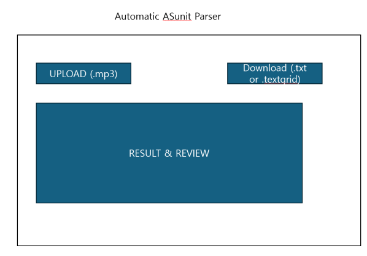
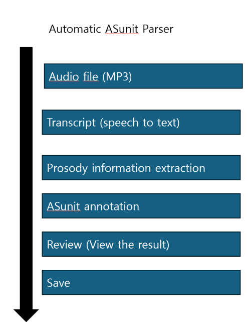

# Automatic AS-unit Annotation Application

**Course:** ICS 603  
**Author:** S Lee

## 1. Project goal

An automatic AS-unit annotation application that helps linguists transcribe speech and segment the resulting transcripts into AS-units.

## 2. Intended user and problem

The intended users are linguists and language researchers who analyze spoken language data using AS-units. Currently, researchers need to transcribe speech and manually segment the transcripts into AS-units, which can be a time-consuming process, particularly when working with large amounts of spoken data. AS-unit segmentation process also involves prosodic cues, such as pauses and falling intonation, in addition to the transcript when determining AS-unit boundaries.

## 3. Example input

The current text-first increment accepts a synthetic English transcript (up to 5,000 Unicode code points) and optional manually supplied prosodic cues (up to 5,000 code points) through the web interface. Blank cues mean no prosodic evidence was supplied. Audio input remains a placeholder; transcription is future work.

## 4. Sample input set

Development and automated tests use only synthetic transcripts, synthetic cue descriptions, and mocked model responses. For example: “A toy robot waved. It rolled away.” No participant recordings, private transcripts, or identifying annotations may be used. Future audio evaluation requires a separately approved nonsensitive dataset and reference annotations.

## 5. Expected result and value

The user will receive an automatically generated transcript segmented into AS-units. The user will be able to review the suggested AS-unit boundaries and correct them when necessary. The application will reduce the amount of manual work required to transcribe and segment spoken data. Improvement will be observed if the automatically generated AS-unit boundaries generally correspond to human-annotated reference boundaries and require fewer manual corrections than annotating the transcript from scratch.

## 6. Big-picture sketch

The current interface has a synthetic-text form with optional manual cues, AI-suggested segmentation and original UI character positions, and a browser-local correction area. The original audio upload, placeholder result area, and disabled download controls remain available. No database, disk persistence, or download is implemented.

The broader proposed workflow remains Upload Audio, Transcript & AS-unit Annotation, and Save Result.

## 7. Workflow or component sketch

## 8. Data source and access

Only synthetic text and manually supplied synthetic prosodic cues are permitted for this increment. The app sends them to the configured AI provider for the current request; it does not deliberately log or persist them. No private research datasets, participant data, personal identifying information, or credentials may be included. Provider-side retention is governed by the selected service's settings and terms.

## 9. Core features

- **Current increment — AI AS-unit suggestions from text:** Submit synthetic text with optional manual prosodic cues and receive provisional segmented text and original boundary positions for human review.
- **Speech transcription (future):** Transcribe uploaded speech audio into text. The existing audio endpoint still returns fixed placeholders.
- **Prosodic feature extraction (future):** Extract pauses and intonation from audio. Current cues are user supplied; missing cues are never invented.
- **AS-unit annotation:** Use syntax and any supplied evidence to suggest AS-unit boundaries. Automated suggestions require human review and are not validated research annotations.

## 10. LLM role

Use a configured pretrained OpenAI-compatible model through Pydantic AI, without training, fine-tuning, RAG, or a database. Credentials and provider settings are read only on the server from `LLM_API_TOKEN`, `LLM_API_GATEWAY` (the compatible API base URL), and `LLM_MODEL`. Missing configuration disables text analysis with a safe message; the audio placeholder still works. Never commit credentials or return them to the browser.

The prompt treats an AS-unit as an independent clause or subclausal unit together with associated subordinate clauses. Syntax and explicitly supplied prosodic cues support provisional boundaries. The transcript and cues are data, not instructions. Without cues, the model uses text alone and must never invent acoustic information.

**Input:** Synthetic transcript, optional manually supplied cues, and explicit AS-unit criteria.

**Output:** Structured nonempty text segments that concatenate exactly to the original transcript, preserving whitespace, punctuation, and spelling. The server calculates internal boundary positions from segment lengths. These zero-based, end-exclusive Unicode code-point offsets are for the web interface only; they are not equivalent to the word-level boundary positions used in research evaluation. The final text end is omitted.

Allow at most two model requests for invalid output, no automatic transport retries, and a 30-second total annotation deadline. Configuration, timeout, provider, and invalid-output failures return safe messages without payloads or raw provider details. Automated tests disable real model requests and use local mock responses.

## 11. Data use

The application will use (1) AS-unit annotation criteria and rules and (2) the transcript and prosodic features generated from the uploaded audio.

## 12. Saved records

This section describes a future capability; the current text-first increment retains no records.

The application will save the transcript and extracted prosodic features, along with the corresponding AS-unit annotation. The original audio file will not be stored. These records will remain available after the application restarts.

## 13. Searchable text

Search requires future persistence and is not part of the current increment.

Saved transcripts will be searchable. A search result will return the matching transcript together with its accompanying AS-unit annotation.

## 14. Human review

Display original AI segmentation and original boundary positions with context, clearly labeled as provisional. Users can edit the segmented annotation in a browser-local textarea. Original AI boundary positions remain unchanged after edits; the interface explicitly states that they have not been recalculated. No edit is persisted or downloaded. UI character positions must not be presented as research word-level boundary measures. Persistent corrections remain future work.

## 15. Failure case

The transcript and prosodic cues may provide conflicting or ambiguous evidence for an AS-unit boundary. In such cases, the application should provide a suggested boundary and allow the user to review and correct the annotation.

## 16. Acceptance criteria

Current text-first increment:

- Given a nonblank synthetic English transcript of at most 5,000 Unicode code points and optional manual cues of at most 5,000 code points, the interface sends a separate text-analysis request and displays AI-suggested segments that reconstruct the input exactly.
- Given no cues, the response and interface identify them as not supplied; no missing prosodic evidence is invented.
- Original internal boundary positions are displayed as Unicode UI character offsets, explicitly distinguished from research word-level positions.
- Given a review edit, the correction stays local and the original AI positions remain unchanged with an explicit notice that they were not recalculated.
- Invalid input, unavailable model configuration, provider failures, invalid model output, and timeout produce safe errors. Tests use only synthetic data and mocked model responses with real requests disabled.
- The existing audio upload endpoint and placeholder behavior remain functional. Credentials remain server-side, and no transcripts, cues, audio, or edits are persisted by the app.

Future audio/persistence workflow:

- Given a valid English speech audio file, uploading and analyzing it generates a transcript.
- Given a generated transcript and extracted prosodic features, annotation produces suggested AS-unit boundaries.
- A user can correct an incorrectly identified boundary and save the correction.

## 17. Outside version one

Training or fine-tuning a model specifically for AS-unit annotation will not be included. The application will use a pretrained LLM through a prompt-based approach. Large-scale evaluation using speech data from multiple speakers will also be outside the scope of the version 1.

## 18. Open questions

How should audio-derived pause duration and falling intonation be extracted and represented for the LLM in a future increment? How should reviewed annotations be converted to the word-level boundary representation needed for research evaluation? Current UI character offsets do not answer that evaluation question.

## 19. Next investigation

After the text-first workflow, investigate audio-derived prosody and a separately specified word-level evaluation representation. Persistence, audio transcription, and actual research evaluation remain future work. A live synthetic demonstration requires securely configured model access and explicit authorization; automated verification must remain mocked.
