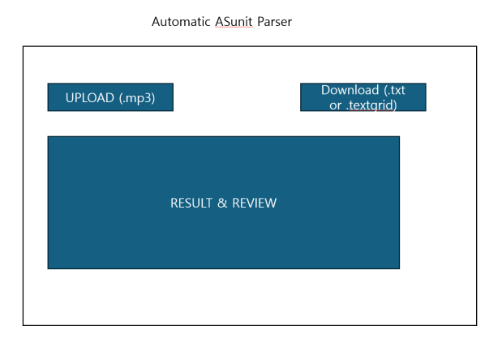
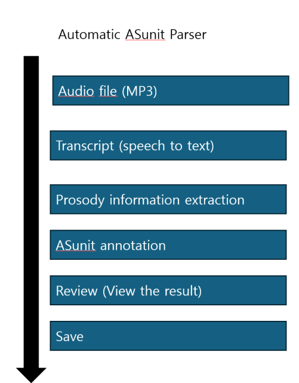

# Automatic AS-unit Annotation Application

**Course:** ICS 603  
**Author:** S Lee

## 1. Project goal

An automatic AS-unit annotation application that helps linguists transcribe speech and segment the resulting transcripts into AS-units.

## 2. Intended user and problem

The intended users are linguists and language researchers who analyze spoken language data using AS-units. Currently, researchers need to transcribe speech and manually segment the transcripts into AS-units, which can be a time-consuming process, particularly when working with large amounts of spoken data. AS-unit segmentation process also involves prosodic cues, such as pauses and falling intonation, in addition to the transcript when determining AS-unit boundaries.

## 3. Example input

A short audio recording of spontaneous English speech (e.g., a WAV or MP3 file containing speech data).

## 4. Sample input set

Five short audio recordings of spontaneous English speech will be recorded by me specifically for this project (real research data cannot be used for ethical reasons). The recordings will be used to test the transcription, prosodic feature extraction, and AS-unit annotation pipeline. Expected AS-unit boundaries will be established through manual annotation for comparison with the application's output.

## 5. Expected result and value

The user will receive an automatically generated transcript segmented into AS-units. The user will be able to review the suggested AS-unit boundaries and correct them when necessary. The application will reduce the amount of manual work required to transcribe and segment spoken data. Improvement will be observed if the automatically generated AS-unit boundaries generally correspond to human-annotated reference boundaries and require fewer manual corrections than annotating the transcript from scratch.

## 6. Big-picture sketch

Four main areas: (1) Upload Audio, where the user uploads an audio file and starts the analysis; (2) Transcript & AS-unit Annotation, where the automatically generated transcript and suggested AS-unit boundaries are displayed (where the user can modify the suggested boundaries); and (3) Save Result, where the reviewed analysis can be downloaded.

## 7. Workflow or component sketch

## 8. Data source and access

The audio data will consist of five short English speech recordings that I will record myself specifically for this project. Existing speech data collected for my research will not be used because of ethical restrictions. The project-created recordings will not include research participant data or sensitive content.

## 9. Core features

- **Speech transcription:** Transcribe uploaded speech audio into text.
- **Prosodic feature extraction:** Extract prosodic information relevant to AS-unit boundary identification, such as pauses and falling intonation, from the audio.
- **AS-unit annotation:** Use the transcript and extracted prosodic information to automatically identify and annotate AS-unit boundaries.

## 10. LLM role

A LLM will be pre-trained based on prompt-based approach rather than being trained or fine-tuned on AS-unit-annotated data. The model will receive the transcript, extracted prosodic features, and explicit AS-unit annotation criteria. It will analyze the syntactic structure of the transcript and integrate this information with prosodic cues, such as pauses and falling intonation, to identify AS-unit boundaries and return a transcript segmented into AS-units.

**Input:** Transcript, extracted prosodic features, and AS-unit annotation criteria.

**Output:** Predicted AS-unit boundaries and an AS-unit-segmented transcript.

## 11. Data use

The application will use (1) AS-unit annotation criteria and rules and (2) the transcript and prosodic features generated from the uploaded audio.

## 12. Saved records

The application will save the transcript and extracted prosodic features, along with the corresponding AS-unit annotation. The original audio file will not be stored. These records will remain available after the application restarts.

## 13. Searchable text

Saved transcripts will be searchable. A search result will return the matching transcript together with its accompanying AS-unit annotation.

## 14. Human review

The user will review the automatically generated AS-unit boundaries and can correct the annotation when necessary.

## 15. Failure case

The transcript and prosodic cues may provide conflicting or ambiguous evidence for an AS-unit boundary. In such cases, the application should provide a suggested boundary and allow the user to review and correct the annotation.

## 16. Acceptance criteria

- Given a valid English speech audio file, when the user uploads the file and runs the analysis, then the application generates a transcript of the speech.
- Given a generated transcript and extracted prosodic features, when the AS-unit annotation is performed, then the application produces a transcript with suggested AS-unit boundaries.
- Given an incorrectly identified AS-unit boundary, when the user reviews the annotation, then the user can correct the boundary and save the corrected annotation.

## 17. Outside version one

Training or fine-tuning a model specifically for AS-unit annotation will not be included. The application will use a pretrained LLM through a prompt-based approach. Large-scale evaluation using speech data from multiple speakers will also be outside the scope of the version 1.

## 18. Open questions

How will pause duration and falling intonation be automatically extracted and represented for use by the LLM?

## 19. Next investigation

I will need to investigate methods for automatically extracting pause duration and falling intonation from speech audio and representing these features in a format that can be read by the LLM.
