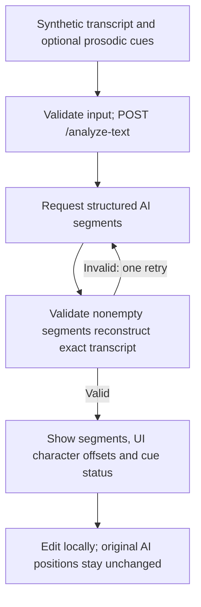

# pr-diagram demonstration

## Scope and test prompt

Tested on public Feature PR #3: https://github.com/SLEE-UH/as-unit-annotation-public/pull/3.

Prompt: “Explain Feature PR #3 to a reviewer with a concise Mermaid feature-flow diagram.”

Evidence was the actual `origin/main...origin/pr-3` diff and PR-head code, not the skill branch's application. Inspected base: `43d8e6595c1522e6089dfb79d2ca03d7068898e8`; head: `7c1ea2652847985d2a9cdbcb2ea752768aa89015`.

## Output

PR #3 adds provisional AI AS-unit suggestions and local human review for synthetic text.

Evidence: `app/page.html` (`text-form`, validation/rendering/review handler); `app/main.py` (`analyze_text`, `get_annotator`); `app/agent.py` (`suggest_as_units`, `validate_segments`); `app/rules.py` (`boundary_offsets`).

Limitations: Error paths are omitted; audio remains a placeholder. Unicode UI character offsets are not research word-level measures. Reading the code does not verify live-model compatibility or prediction quality.

## Tests and revisions

- **Baseline without skill:** A fresh agent produced an accurate but longer 10-node diagram, including separate browser/server validation and error nodes. This exceeded the chosen compact target of seven nodes; no factual failure was observed.
- **Revision:** Added an explicit output contract (one sentence, one diagram with at most seven nodes/eight edges, code evidence, limitations), PR-head reading, and the AS-unit offset/edit distinctions. No application code changed.
- **With skill:** A fresh agent read `AGENTS.md`, selected `pr-diagram` without an explicit skill invocation in the test prompt, and produced the six-node/six-edge diagram above using PR-head code despite the unrelated checkout branch. Manual comparison confirmed each step against the four evidence files.
- **Missing-evidence scenario:** A separate agent was asked to diagram database storage using nonexistent refs and a description-only claim. It reported missing diff/head code and declined to invent the diagram.
- These are small agent application trials, not exhaustive reliability measurements. Mermaid syntax was reviewed; no rendered-diagram validation is claimed. No real model request, private data, file edit by test agents, or PR comment was made.
